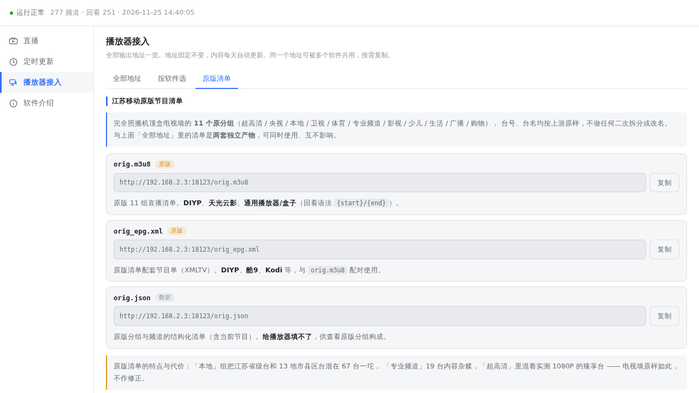

# 江苏移动 IPTV · 飞牛 fnOS 应用

[](https://github.com/justinguo7777/jsydiptv/releases)
[](LICENSE)
[]()
[]()
[]()

把**江苏移动 IPTV（OTT）**的直播频道、回看与节目单，自动整理成播放器能直接用的
M3U / XMLTV / TVBox 配置，并附一个内置 Web 界面做频道预览与试看。

> **一句话**：装一次，每天自动更新；填一个地址，电视/手机/盒子全部能看。
> **不用账号密码** —— 数据走移动 OTT 的 `lvps` 接口，按来源 IP 放行，只需在江苏移动网络下。


## 快速开始

1. 到 [Releases](https://github.com/justinguo7777/jsydiptv/releases) 下载最新的 `jsydiptv-x.y.z.fpk`
2. 飞牛「应用中心」→ 右上角「手动安装」→ 选择该 fpk
3. 向导里**只需填服务端口**（默认 `18123`），点完成
4. 浏览器打开 `http://<NAS-IP>:18123`，看频道列表；再到「播放器接入」页复制地址填进播放器

> 装好后在「应用设置」里可调：地市、每天更新时间、节目单天数、输出模式等。

## 两套清单，按需选择

本应用同时产出**两套互不影响的清单**，装好后都在「播放器接入」页能看到地址：

| | 智能分组清单（默认推荐） | 原版清单 |
|---|---|---|
| 文件 | `iptv.m3u8` / `kodi.m3u` / `fongmi.m3u` | `orig.m3u8` |
| 分组 | 按内容细分：4K / 央视 / 卫视 / 江苏 / 地方(按市) / 影视剧场 / 少儿动画 / 体育竞技 / 生活纪录 / 音乐广播 / 购物 | **完全照搬机顶盒电视墙 11 组**（超高清/央视/本地/卫视/体育/专业频道/影视/少儿/生活/广播/购物） |
| 4K | 实测分辨率后单独成组并置顶，真 4K / 高清臻享 分开标注 | 沿用上游「超高清」组，真伪不标注 |
| 适合 | 想直接能用的、讨厌台乱混在一起的 | 习惯机顶盒那套分组顺序的 |

> 想看**电视墙原样**就用原版清单；想**分类清楚好找台**就用智能分组清单。

## 功能

| 能力 | 说明 |
|---|---|
| 全量频道表 | 江苏 13 地市聚合去重，实测 277 个频道 / 22 个分组 |
| **4K 分组（置顶）** | CCTV 台在最前按台号升序；含真 4K 与「高清臻享」，按**实测分辨率**标注真伪（20 个中 14 个真 4K） |
| **智能分组** | 4K / 央视 / 卫视 / 江苏 / 地方(按市) / 影视剧场 / 少儿动画 / 体育竞技 / 生活纪录 / 音乐广播 / 购物，不再有「其他」大杂烩 |
| 一键展开/折叠 | 频道列表可一键展开或折叠所有分组，折叠状态跨刷新保留 |
| **原版清单** | 另出一套 `orig.m3u8` / `orig_epg.xml` / `orig.json`，**完全照搬机顶盒电视墙 11 组**（289 条 / 265 个唯一频道），与智能分组清单并存 |
| 节目单 EPG | 前 7 天 ~ 后 3 天，实测约 7 万条 programme |
| 回看 catchup | 模板化时钟地址，运营商保留约 7 天 |
| 台标本地化 | 抓回 NAS 本地，哈希命名，避免外网掉图 |
| 多播放器格式 | M3U8 / Kodi / FongMi / 酷9 / TVBox / DIYP / 组播 |
| 内置预览 | 频道列表 + 直播试看 + 流规格探测（分辨率/编码/码率） |
| 定时更新 | 默认每天 03:30，可在应用设置中修改 |
| 自检与原子发布 | 抽样实测可播 + 隐私扫描，通过才替换正式文件 |
| 纯标准库 | 服务端零第三方依赖，Python 3.8+ |

## 安装

1. 飞牛「应用中心」→ 右上角「手动安装」→ 选择 `jsydiptv-1.7.0.fpk`
2. 向导里只需设置 **服务端口**（默认 18123）；地市、更新时间、输出模式等装好后到「应用设置」里调
3. 装完首次启动会同步拉一次全量数据（局域网约 13 秒）

> 最新版请到 [Releases](https://github.com/justinguo7777/jsydiptv/releases) 下载 `jsydiptv-1.7.0.fpk`。
> 历史版本（1.0–1.6.0）均有已知缺陷或已被 1.7.0 取代，不建议使用。

> ⚠️ 建议不要改端口：服务会跟着切，但 fnOS 桌面入口在安装时固定，
> 改端口后图标打不开（需重装一次让入口重新注册）。

## 播放器接入

| 播放器 | 地址 |
|---|---|
| **FongMi TV** | `http://<NAS>:18123/fongmi.json`（直播+回看+节目单一条通） |
| **酷9 / 电视直播** | `http://<NAS>:18123/fongmi.m3u` + EPG `http://<NAS>:18123/epg.xml` |
| TVBox / 影视仓 | `http://<NAS>:18123/tvbox.json` |
| DIYP | `http://<NAS>:18123/iptv.m3u8` + EPG `http://<NAS>:18123/epg.xml` |
| Kodi PVR | `http://<NAS>:18123/kodi.m3u` + EPG `http://<NAS>:18123/epg.xml` |
| 天光云影 | `http://<NAS>:18123/iptv.m3u8`（**不支持回看**） |
| 4K 清单 | `http://<NAS>:18123/4k.json` |
| **原版清单** | `http://<NAS>:18123/orig.m3u8` + `http://<NAS>:18123/orig_epg.xml`（照搬上游 11 组） |

### 回看占位符方言（踩过的坑）

不同播放器的 catchup 占位符不通用的，本应用同时输出三种：

| 文件 | 占位符 | 适用 |
|---|---|---|
| `iptv.m3u8` | `{start}` / `{end}` | DIYP、通用播放器 |
| `kodi.m3u` | `${start}` / `${end}` | Kodi PVR IPTV Simple |
| `fongmi.m3u` | `${(b)yyyyMMddHHmmss}` | FongMi、**酷9**、电视直播(mytv-android) |

> 酷9 与 FongMi 的占位符一致，所以共用 `fongmi.m3u`，**不能**给它们 `kodi.m3u`。
> 另外酷9 的 EPG「解析格式」**必须手动改成 XmlTV**（默认是 DIYP，否则节目单一直空着）。

### 界面预览

「播放器接入」页把全部输出地址列出来，每一条都标注**能在哪些软件里用**，不用自己猜：



## 关于 4K 频道

- 4K 组包含两类：**真 4K**（实测 3840×2160）与「**高清臻享**」（运营商高码率档）。
- 每次更新都会实拉切片解析 SPS 拿真实分辨率：真 4K 打蓝色「4K」徽标，实测只有 1080P 的高清臻享打紫色「臻享」徽标并注明真实分辨率，不谎报为 4K。
- 实测 20 个 4K 组频道中 **14 个真 4K**（11 个 H.265/HEVC + 3 个 H.264），另 6 个高清臻享为 1080P。
- 4K 组内 CCTV 台置顶并按台号升序（CCTV-1 4K → CCTV-16 4K → 央视4K → 各卫视 4K）。
- ⚠️ **播放设备不支持 HEVC 时，4K 台会出现「有声音、画面全黑」**——这不是源坏了。
  网页预览里会说明原因并提供「切到低清晰度」按钮降成 1080P；
  电视端播放器（酷9 / 电视直播 / FongMi / 影视仓）通常能硬件解码，可直接看 4K。

## 接口与实现

数据来源与参数见 [DEVELOPMENT-REPORT.md](DEVELOPMENT-REPORT.md)，要点：

```
EPG_BASE = http://lvpepg.uni.jsa.bcs.ottcn.com:8080/cms-lvp-epg
channelList          ?assortId=115&serviceChannelId=&abilityString={编码后JSON}
getOpenNewAssortment ?serviceChannelId=&abilityString=...     # 原版分组
getAllProgramlist    ?startDate&endDate&pos=fullplayer&allDay=true&uuid=...
abilityString        {"deviceGroupIds":["1697"],"districtCode":"320100"}
UA                   okhttp/3.12.0
```

地址模板：

```
live  = {cdn}/{cp}/live1/{code}/{code}/1.m3u8
back  = {cdn}/{cp}/lookback/{code}/{code}?playseek={start}-{end}
```

### 分组是怎么来的

上游 `getOpenNewAssortment` 只给 11 个**粗**分组（超高清/央视/本地/卫视/体育/专业频道/
影视/少儿/生活/广播/购物），它**分不出**「江苏省级台」和「13 个地市的地方台」。

所以分类链路是：

1. 粗分组 → 取上游，原样存进 `otype`（**分组归属表必须用全省视角 `districtCode=320000`**，
   南京视角只覆盖 211/266 台，会让其余地市 55 台丢掉 `otype` 变成「假孤儿」）
2. **4K** → 本应用实测分辨率后单独抽出并置顶（真 4K / 高清臻享 按实测标注）
3. **省级台** → 取 13 个地市各自的 `assortId=120`「本地」清单做**交集**（8 个）
4. **地方台** → 13 市交集法的差集（59 个）与上游 `isLocal`（**全省视角**）**并行取并集**，
   归入所属城市；任一法认定是地方台就按地方台处理，上游新增县区台不会漏
5. 其余 → 按内容拆成 影视剧场 / 少儿动画 / 体育竞技 / 生活纪录 / 音乐广播 / 购物
6. **孤儿频道**（上游未归任何分组、无 `otype`）→ 名称兜底，并写入 `meta.json` 的 `orphans` 告警

## 开发

```bash
# 源码结构
fpk/
├── manifest          # 应用元信息
├── ICON.PNG          # 64x64 包图标
├── ICON_256.PNG      # 256x256 包图标
├── app/
│   ├── server/       # server.py（HTTP + 抓取 + 生成）、media_probe.py（TS 解析）
│   ├── www/          # index.html（单文件前端）、hls.min.js
│   └── ui/           # 桌面入口配置与图标
├── cmd/              # start/stop/status、安装与配置回调
├── config/           # privilege、resource
└── wizard/           # 安装向导表单
```

打包（根层必须是 4 个文件 + 三个目录）：

```bash
# ⚠️ app.tgz 顶层必须直接是 server/ ui/ www/，不能套一层 app/（1.1.0 就是这么翻车的）
cd fpk/app && tar czf ../app.tgz server ui www && cd ..
tar czf jsydiptv-x.y.z.fpk ICON.PNG ICON_256.PNG app.tgz manifest cmd config wizard
```

权限：`manifest`/图标 644，`cmd/` `wizard/` `config/` 目录 755，`cmd/*` 脚本 755。

验收脚本：

```bash
python3 verify/round1_api.py          # 接口/产物/数据/安全 34 项
# verify/round2_ui.js 在浏览器控制台执行  # UI/交互 29 项
```

## 使用限制

- 直播源按**来源 IP** 放行，**必须在江苏移动网络下**才能播放
- 回看约 7 天，超期由运营商侧失效
- 不含任何账号、令牌、MAC、机顶盒绑定信息（发布前 4 类规则强制扫描）
- 监听 `0.0.0.0`，仅应在**内网**使用；外网访问请自行加反代与鉴权
- 仅供个人自用，请勿大规模传播（CDN 有并发限制）

## 致谢

上游血统来自 TVBox 系与 FongMi TV 专版两套外围包的分组与产物结构调研，
详见 [UPSTREAM-COMPARE.md](UPSTREAM-COMPARE.md)。

## License

本项目采用 MIT License，详见 [LICENSE](LICENSE)。
