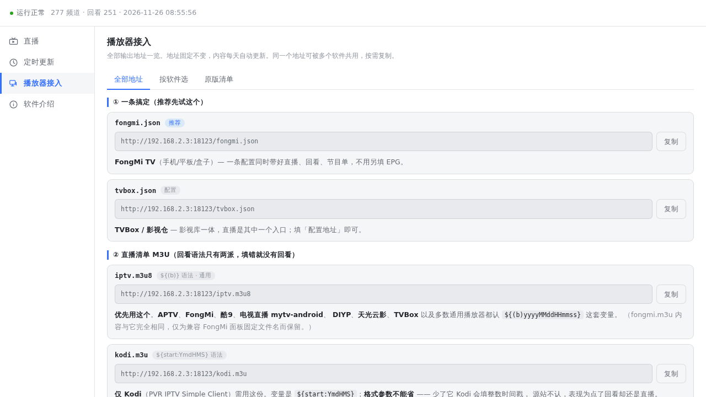

<div align="center">


# 江苏移动 IPTV · 飞牛 fnOS 应用

把江苏移动电视直播变成你自己的、能长期用的 IPTV 服务

[](https://github.com/justinguo7777/jsydiptv/releases) [](LICENSE) []() []() []()

**277 个频道 · 251 个可回看 · 7 天节目单 · 4K 实测标注 · 每天自动更新**

[快速开始](#quickstart) · [两套清单](#two-lists) · [播放器接入](#players) · [常见问题](#faq) · [交流与反馈](#community)

</div>


---

## 这是什么

把**江苏移动 IPTV（OTT）**的直播频道、回看与节目单，自动整理成播放器能直接用的 M3U / XMLTV / TVBox 配置，并附带一个内置 Web 界面做频道预览与试看。

**装一次，每天自动更新；填一个地址，电视、手机、盒子全部能看。**

### 为什么会有这个项目

机顶盒那套体验其实很差：遥控器按半天、分组混乱、回看要来回切、节目单只有当前频道。但直播源本身是好的 —— 只要能把它整理成标准格式，手机、电视、平板、电脑就都能看，还能用上成熟的播放器生态（回看、节目单、收藏、多屏）。

这个项目做的事就是：**把运营商的数据挖出来、分类整理好、适配各家播放器的方言**，让你不用折腾。

### 核心特性

| | |
|---|---|
| 🎯 **不用账号密码** | 数据走移动 OTT 的 `lvps` 接口，按来源 IP 放行，只要在江苏移动网络下 |
| 📺 **全量频道** | 江苏 13 地市聚合去重，实测 **277 个频道 / 22 个分组** |
| ⏪ **回看能用** | **251 个频道支持回看**，按各播放器语法分别产出，不再出现"点了还是直播" |
| 📅 **7 天节目单** | 前 7 天 ~ 后 3 天，约 **7 万条**节目，准确对上频道 |
| 🔍 **4K 不虚标** | 20 个 4K 组频道 **实测分辨率**后标注真伪（14 个真 4K，其中 11 个 H.265） |
| 🗂️ **智能分组** | 不再有"其他"大杂烩，按内容细分成 11 组，也可以一键切回机顶盒原样 |
| 🖼️ **台标本地化** | 抓回 NAS 本地、哈希命名，不依赖外网、不掉图 |
| 🔄 **定时更新** | 默认每天 03:30 自动刷新，可在应用设置里改 |
| ✅ **自检与原子发布** | 抽样实测可播 + 隐私扫描，**通过才替换正式文件**，坏了保留上一版 |
| 📦 **零第三方依赖** | 服务端纯标准库，Python 3.8+，装完就能跑 |

---

<a id="quickstart"></a>

## 🚀 快速开始

**前提**：一台装了飞牛 fnOS 的 NAS，且处在江苏移动宽带网络下。

1. 到 [Releases](https://github.com/justinguo7777/jsydiptv/releases) 下载最新的 `jsydiptv-x.y.z.fpk`
2. 飞牛「应用中心」→ 左下角「手动安装」→ 选择该 fpk
3. 向导里**只需填服务端口**（默认 `18123`），点完成
4. 浏览器打开 `http://<NAS-IP>:18123` 看频道列表，再到「播放器接入」页复制地址填进播放器

> 装好后在「应用设置」里可调：地市、每天更新时间、节目单天数、输出模式等。
> 首次启动会同步拉一次全量数据，局域网约 13 秒。

> ⚠️ **建议不要改端口**：服务会跟着切，但 fnOS 桌面入口在安装时固定，改端口后图标打不开（需重装一次让入口重新注册）。

---

<a id="two-lists"></a>

## 📋 两套清单，按需选择

本应用同时产出**两套互不影响的清单**，装好后都在「播放器接入」页能看到地址：

| | 智能分组清单（默认推荐） | 原版清单 |
|---|---|---|
| 文件 | `iptv.m3u8` / `kodi.m3u` / `fongmi.m3u` | `orig.m3u8` |
| 分组 | 按内容细分：4K / 央视 / 卫视 / 江苏 / 地方(按市) / 影视剧场 / 少儿动画 / 体育竞技 / 生活纪录 / 音乐广播 / 购物 | **完全照搬机顶盒电视墙 11 组**（超高清/央视/本地/卫视/体育/专业频道/影视/少儿/生活/广播/购物） |
| 4K | 实测分辨率后单独成组并置顶，真 4K / 高清臻享 分开标注 | 沿用上游「超高清」组，真伪不标注 |
| 适合 | 想直接能用的、讨厌台乱混在一起的 | 习惯机顶盒那套分组顺序的 |

> 想看**电视墙原样**就用原版清单；想**分类清楚好找台**就用智能分组清单。

---

<a id="players"></a>

## 📺 播放器接入

| 播放器 | 地址 | 回看 |
|---|---|:---:|
| **FongMi TV** | `http://<NAS>:18123/fongmi.json`（直播+回看+节目单一条通） | ✅ |
| **酷9 / 电视直播** | `http://<NAS>:18123/iptv.m3u8` + EPG `http://<NAS>:18123/epg.xml` | ✅ |
| **APTV**（iOS） | `http://<NAS>:18123/iptv.m3u8` + EPG `http://<NAS>:18123/epg.xml` | ✅ |
| TVBox / 影视仓 | `http://<NAS>:18123/tvbox.json` | ✅ |
| DIYP | `http://<NAS>:18123/iptv.m3u8` + EPG `http://<NAS>:18123/epg.xml` | ✅ |
| Kodi PVR | `http://<NAS>:18123/kodi.m3u` + EPG `http://<NAS>:18123/epg.xml` | ✅ |
| 天光云影 | `http://<NAS>:18123/iptv.m3u8` | ❌ |
| 4K 清单 | `http://<NAS>:18123/4k.json` | — |
| **原版清单** | `http://<NAS>:18123/orig.m3u8` + `http://<NAS>:18123/orig_epg.xml` | ✅ |

### ⚠️ 回看语法：填错就没有回看

不同播放器的回看占位符**互不兼容**，这是最容易踩的坑（以下结论均来自各播放器**源码**，不是猜的）：

| 文件 | 占位符语法 | 适用 |
|---|---|---|
| `iptv.m3u8`<br>`fongmi.m3u`<br>`orig.m3u8` | `${(b)yyyyMMddHHmmss}` / `${(e)yyyyMMddHHmmss}` | **APTV、FongMi、酷9、mytv-android、DIYP、TVBox** 及多数通用播放器 |
| `kodi.m3u` | `${start:YmdHMS}` / `${end:YmdHMS}` | **仅 Kodi**（PVR IPTV Simple Client） |

**两个必须知道的细节**：

- **Kodi 的格式参数不能省**。写成 `${start}` 会变成整数时间戳（如 `1795610700`），源站不认，表现就是「点了回看还是直播」。
- **`fongmi.m3u` 与 `iptv.m3u8` 内容完全相同**，只是 FongMi 面板只认这个文件名。

> 另外：**酷9 的 EPG「解析格式」必须手动改成 XmlTV**（默认是 DIYP），否则节目单一直空着。



---

## 📖 关于 4K 频道

- 4K 组包含两类：**真 4K**（实测 3840×2160）与「**高清臻享**」（运营商高码率档）。
- 每次更新都会实拉切片解析 SPS 拿真实分辨率：真 4K 打蓝色「4K」徽标，实测只有 1080P 的臻享档打紫色「臻享」徽标并注明真实分辨率，**不谎报为 4K**。
- 当前实测：20 个 4K 组频道中 **14 个真 4K**（11 个 H.265/HEVC + 3 个 H.264），另 6 个为 1080P 臻享档。
- 4K 组内 CCTV 台置顶并按台号升序（CCTV-1 4K → CCTV-16 4K → 央视4K → 各卫视 4K）。
- ⚠️ **播放设备不支持 HEVC 时，4K 台会出现「有声音、画面全黑」** —— 这不是源坏了。
  网页预览里会说明原因并提供「切到低清晰度」按钮降成 1080P；电视端播放器（酷9 / 电视直播 / FongMi / 影视仓）通常能硬解，可直接看 4K。

---

## 🧠 分类是怎么来的

上游 `getOpenNewAssortment` 只给 11 个**粗**分组（超高清/央视/本地/卫视/体育/专业频道/影视/少儿/生活/广播/购物），它**分不出**「江苏省级台」和「13 个地市的地方台」。

所以分类链路是：

1. **粗分组** → 取上游原样存进 `otype`（分组归属表必须用**全省视角** `districtCode=320000`；用南京视角只覆盖 211/266 台，会让其余地市 55 台丢掉 `otype` 变成「假孤儿」）
2. **4K** → 实测分辨率后单独抽出并置顶（真 4K / 臻享 按实测标注）
3. **省级台** → 取 13 个地市各自的「本地」清单做**交集**
4. **地方台** → 13 市交集法的差集与上游 `isLocal`（**全省视角**）**并行取并集**，归入所属城市；任一法认定是地方台就按地方台处理，上游新增县区台不会漏
5. **其余** → 按内容拆成 影视剧场 / 少儿动画 / 体育竞技 / 生活纪录 / 音乐广播 / 购物
6. **孤儿频道**（上游未归任何分组、无 `otype`）→ 名称兜底，并写入 `meta.json` 的 `orphans` 告警

---

<a id="faq"></a>

## ❓ 常见问题

<details>
<summary><b>装了但打不开网页 / 桌面图标点了白屏</b></summary>

- 确认容器**正在运行**：应用中心里看状态是不是 running
- 确认端口没被占用：`ss -lnt | grep 18123`
- 改过端口的话，桌面入口会失效（安装时注册的），需要重装一次
</details>

<details>
<summary><b>频道能看，但回看点了还是直播</b></summary>

按顺序排查：

1. **播放器选错清单**。Kodi 必须用 `kodi.m3u`，其他都用 `iptv.m3u8`
2. **回看已过期**。运营商只保留约 7 天，更早的节目点了没用
3. **不在江苏移动网络下**。直播源按来源 IP 放行，换了网络就播不了

本项目 1.7.1 已修正 `catchup` 模式错误（append → default），早期版本必然没回看，建议升级。
</details>

<details>
<summary><b>4K 台有声音没画面 / 画面全黑</b></summary>

设备不支持 HEVC 硬解。网页预览里点「切到低清晰度」降成 1080P；电视端换酷9 / 电视直播 / FongMi 等支持硬解的播放器。
</details>

<details>
<summary><b>节目单是空的（酷9）</b></summary>

酷9 的 EPG「解析格式」默认是 DIYP，**必须手动改成 XmlTV**。
</details>

<details>
<summary><b>更新后清单还是旧的</b></summary>

清单不是启动时生成的，由定时任务产出。装完新版本或改完配置，要到网页上点一次「立即更新」，或等下次定时任务。
</details>

<details>
<summary><b>能不能在江苏以外用</b></summary>

直播源按来源 IP 放行，**必须在江苏移动网络下**才能播放。外网访问 NAS 的网页界面可以，但播放会失败。
</details>

---

## ⚠️ 使用限制

- 直播源按**来源 IP** 放行，**必须在江苏移动网络下**才能播放
- 回看约 7 天，超期由运营商侧失效
- 不含任何账号、令牌、MAC、机顶盒绑定信息（发布前 4 类规则强制扫描）
- 监听 `0.0.0.0`，仅应在**内网**使用；外网访问请自行加反代与鉴权
- 仅供个人自用，请勿大规模传播（CDN 有并发限制）

---

## 🛠️ 开发

数据来源与接口参数见 [DEVELOPMENT-REPORT.md](DEVELOPMENT-REPORT.md)，要点：

```
EPG_BASE = http://lvpepg.uni.jsa.bcs.ottcn.com:8080/cms-lvp-epg
channelList          ?assortId=115&serviceChannelId=&abilityString={编码后JSON}
getOpenNewAssortment ?serviceChannelId=&abilityString=...
getAllProgramlist    ?startDate&endDate&pos=fullplayer&allDay=true&uuid=...
abilityString        {"deviceGroupIds":["1697"],"districtCode":"320000"}
UA                   okhttp/3.12.0
```

地址模板：

```
live  = {cdn}/{cp}/live1/{code}/{code}/1.m3u8
back  = {cdn}/{cp}/lookback/{code}/{code}?playseek={start}-{end}
```

E2E 回看验证：

```bash
# 用清单里的模板生成地址后，直接探测时长是否等于节目时长
ffprobe -v error -show_entries format=duration -of csv=p=0 "<回看地址>"
```

### 源码结构

```
fpk/
├── manifest          # 应用元信息
├── ICON.PNG          # 64x64 包图标
├── ICON_256.PNG      # 256x256 包图标
├── app/
│   ├── server/       # server.py（HTTP + 抓取 + 生成）、media_probe.py（TS 解析）
│   ├── www/          # index.html（单文件前端）、hls.min.js
│   └── ui/           # 桌面入口配置与图标
├── cmd/              # start/stop/status、安装与配置回调
├── config/           # privilege、resource
└── wizard/           # 安装向导表单
```

### 打包

根层必须是 **4 个文件（`ICON.PNG` `ICON_256.PNG` `app.tgz` `manifest`）+ 3 个目录（`cmd` `config` `wizard`）**：

```bash
# ⚠️ app.tgz 顶层必须直接是 server/ ui/ www/，不能套一层 app/
cd fpk/app && tar czf ../app.tgz server ui www && cd ..
tar czf jsydiptv-x.y.z.fpk ICON.PNG ICON_256.PNG app.tgz manifest cmd config wizard
```

权限：`manifest` / 图标 644，`cmd/` `wizard/` `config/` 目录 755，`cmd/*` 脚本 755。

### 验收脚本

```bash
python3 verify/round1_api.py          # 接口/产物/数据/安全 34 项
# verify/round2_ui.js 在浏览器控制台执行  # UI/交互 29 项
```

---

<a id="community"></a>

## 💬 交流与反馈

<div align="center">

用的时候遇到问题、发现 bug、想要新功能，或者只是想说声谢谢，都可以来这里。

**有问题和有想法欢迎进群沟通交流**


<sub>群二维码 7 天内有效，过期请提 <a href="https://github.com/justinguo7777/jsydiptv/issues">Issue</a> 提醒更新</sub>

</div>

- 🐛 **Bug / 功能建议** → [Issues](https://github.com/justinguo7777/jsydiptv/issues)
- ⭐ 觉得好用 → 点个 **Star**，是最大的鼓励

---

## 🙏 致谢

- 感谢恩山 **lff520520** 提供思路和实现方案：[原贴地址](https://www.right.com.cn/forum/thread-8499027-1-2.html)
- 上游血统来自 TVBox 系与 FongMi TV 专版两套外围包的分组与产物结构调研，详见 [UPSTREAM-COMPARE.md](UPSTREAM-COMPARE.md)

## License

本项目采用 [MIT License](LICENSE)。

<div align="center">

**仅供个人学习与自用，请勿用于商业用途或大规模传播**

</div>