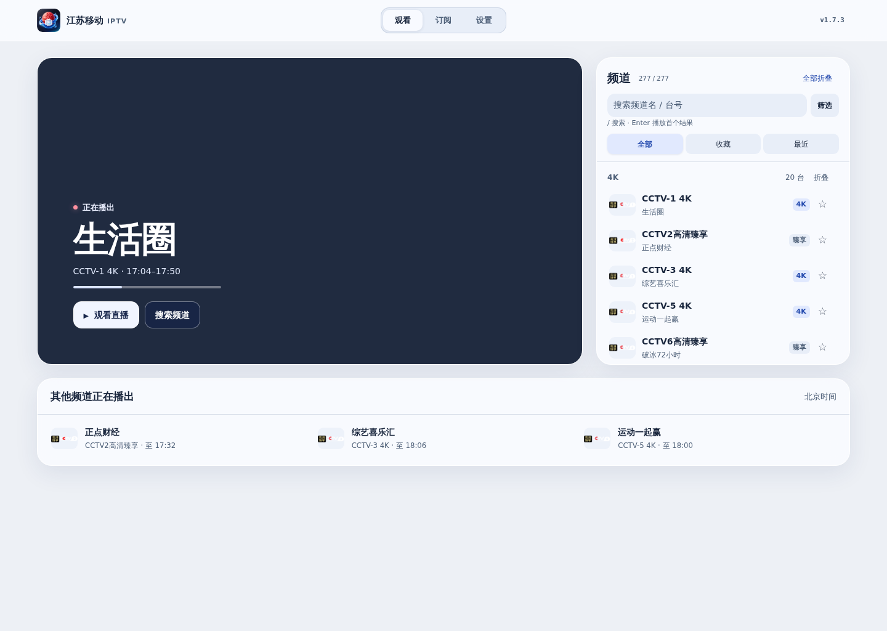

# 江苏移动 IPTV · 飞牛 fnOS 应用

把江苏移动电视直播变成你自己的、能长期用的 IPTV 服务

   

**江苏移动 IPTV 直播与回看 · 4K 实测标注 · 每天自动更新**

[快速开始](#quickstart) · [两套清单](#two-lists) · [播放器接入](#players) · [常见问题](#faq) · [交流与反馈](#community)

---

## 这是什么

把 **江苏移动 IPTV（OTT）** 的直播频道、回看与节目单，自动整理成播放器能直接用的 M3U / XMLTV / TVBox 配置，并附带一个内置 Web 界面做频道预览与试看。

默认每天自动更新。电视、手机和盒子可按播放器类型选择订阅地址。

### 为什么会有这个项目

机顶盒那套体验其实很差：遥控器按半天、分组混乱、回看要来回切、节目单只有当前频道。但直播源本身是好的 —— 只要能把它整理成标准格式，手机、电视、平板、电脑就都能看，还能用上成熟的播放器生态（回看、节目单、收藏、多屏）。

这个项目做的事就是：**把运营商的数据挖出来、分类整理好、适配各家播放器的方言**，让你不用折腾。

### 核心特性

| | |
|---|---|
| 🎯 **不用账号密码** | 数据走移动 OTT 的 `lvps` 接口，按来源 IP 放行，只要在江苏移动网络下 |
| 📺 **全量频道** | 江苏 13 地市聚合去重，`v1.7.3` 全省验收时约 **277 个频道**；以当前生成结果为准 |
| ⏪ **回看能用** | `v1.7.3` 验收样本有 **251 个带回看模板的频道**；实际可回看范围由运营商决定 |
| 📅 **节目单** | 默认采集过去 7 天和未来 3 天。不同导出格式的节目单覆盖范围见下文 |
| 🔍 **4K 不虚标** | 只有实测宽高达到 3840×2160 才标真 4K；探测不到则标为待探测 |
| 🗂️ **智能分组** | 不再有"其他"大杂烩，按内容细分成 11 组，另有按机顶盒上游分组重建的清单 |
| 🖼️ **台标本地化** | 可以将可下载的台标缓存到 NAS；效果取决于台标源和当前配置 |
| 🔄 **定时更新** | 默认每天 03:30 自动刷新，可在应用设置里改 |
| ✅ **自检与原子发布** | 抽样检查直播清单、校验整代文件并扫描文本隐私字段；通过后一次切换，失败保留上一代 |
| 📦 **无需安装 Python 第三方包** | 服务端用 Python 3.8+ 标准库；网页内置 hls.js |

---

## 🚀 快速开始

**前提**：飞牛 fnOS **1.1.3100 或更高版本**、设备上可用的 Python 3.8+，并处在能访问江苏移动 IPTV 源的网络。

1. 到 [Releases](https://github.com/justinguo7777/jsydiptv/releases) 下载最新的 `jsydiptv-x.y.z.fpk`
2. 飞牛「应用中心」→ 左下角「手动安装」→ 选择该 fpk
3. 向导里**只需填服务端口**（默认 `18123`），点完成
4. 浏览器打开 `http://<NAS-IP>:<安装端口>`（默认 `18123`） 看频道列表，再到「订阅」页复制地址填进播放器

> 网页「设置」可调自动更新、输出模式和节目单开关；地市、节目单采集天数和回看天数等在飞牛「应用设置」调整。
> 无历史产物时，首次启动先开放网页服务，再在后台更新，耗时取决于网络与节目量。已有产物的升级会沿用旧清单，直到下一次成功更新。

> ⚠️ **建议不要改端口**：服务会跟着切，但 fnOS 桌面入口在安装时固定，改端口后图标打不开（需重装一次让入口重新注册）。

---

## 📋 两套清单，按需选择

本应用同时产出**同一批数据的两套分组视图**，装好后都在「订阅」页能看到地址：

| | 智能分组清单（默认推荐） | 原版清单 |
|---|---|---|
| 文件 | `iptv.m3u8` / `kodi.m3u` / `fongmi.m3u` | `orig.m3u8` / `orig_epg.xml` / `orig.json` |
| 分组 | 按内容细分：4K / 央视 / 卫视 / 江苏 / 地方(按市) / 影视剧场 / 少儿动画 / 体育竞技 / 生活纪录 / 音乐广播 / 购物 | **按机顶盒电视墙上游 11 组重建**（超高清/央视/本地/卫视/体育/专业频道/影视/少儿/生活/广播/购物） |
| 4K | 真 4K 和高清臻享同组置顶，同台优先保留实测 4K | 沿用上游「超高清」组，同组同台优先保留实测 4K |
| 适合 | 想直接能用的、讨厌台乱混在一起的 | 习惯机顶盒分组的；保留上游组归属，不保证与机顶盒排序完全相同 |

> 想看**上游电视墙的分组方式**就用原版清单；想**分类清楚好找台**就用智能分组清单。

---

## 📺 播放器接入

| 播放器 | 地址 | 回看 |
|---|---|:---:|
| **FongMi TV** | `http://<NAS>:18123/fongmi.json`（直播+回看+节目单一条通） | ✅ |
| **酷9 / 电视直播** | `http://<NAS>:18123/iptv.m3u8` + EPG `http://<NAS>:18123/epg.xml` | ✅ |
| **APTV**（iOS） | `http://<NAS>:18123/iptv.m3u8` + EPG `http://<NAS>:18123/epg.xml` | ✅ |
| TVBox / 影视仓 | `http://<NAS>:18123/tvbox.json` | ✅ |
| DIYP | `http://<NAS>:18123/iptv.m3u8` + EPG `http://<NAS>:18123/epg.xml` | ✅ |
| Kodi PVR | `http://<NAS>:18123/kodi.m3u` + EPG `http://<NAS>:18123/epg.xml` | ✅ |
| 天光云影 | `http://<NAS>:18123/iptv.m3u8` | ❌ |
| 4K 分组索引（JSON，不是播放器清单） | `http://<NAS>:18123/4k.json` | — |
| **原版清单** | `http://<NAS>:18123/orig.m3u8` + `http://<NAS>:18123/orig_epg.xml` | ✅ |

### ⚠️ 回看语法：填错就没有回看

不同播放器的回看占位符**互不兼容**，这是最容易踩的坑。下表说明项目输出的语法与建议接入方式，不代表所有客户端版本都已实机验证：

| 文件 | 占位符语法 | 适用 |
|---|---|---|
| `iptv.m3u8` `fongmi.m3u` `orig.m3u8` | `${(b)yyyyMMddHHmmss}` / `${(e)yyyyMMddHHmmss}` | **APTV、FongMi、酷9、mytv-android、DIYP、TVBox** 及多数通用播放器 |
| `kodi.m3u` | `${start:YmdHMS}` / `${end:YmdHMS}` | **仅 Kodi**（PVR IPTV Simple Client） |

**两个必须知道的细节**：

- **Kodi 的格式参数不能省**。写成 `${start}` 会变成整数时间戳（如 `1795610700`），源站不认，表现就是「点了回看还是直播」。
- **`fongmi.json` 会引用 `fongmi.m3u` 和按日节目单**。Kodi 应使用自己的清单和 XMLTV，并在 IPTV Simple 中启用回看。两者的回看时间默认使用播放设备的系统时区，请设置为 `Asia/Shanghai`。[FongMi 配置](https://fongmi.github.io/TV/config/) · [Kodi IPTV Simple](https://github.com/kodi-pvr/pvr.iptvsimple#catchup)

> 另外：**酷9 的 EPG「解析格式」必须手动改成 XmlTV**（默认是 DIYP），否则节目单一直空着。

---

### 输出模式与节目单

- 精简和完整模式均提供通用 M3U、Kodi、FongMi、TVBox、XMLTV 与原版分组三件套。完整模式额外输出 TXT、CSV 等格式。
- 启用 EPG 时，XMLTV 最多覆盖前 5 天至次日，以实际取得的数据为准。FongMi 一条通的按日 JSON 覆盖当天及配置范围内的未来日期，历史节目可使用 XMLTV 清单查看。保留至少一天的未来抓取窗口，可在午夜到次日更新之间延续当天节目单。
- 关闭 EPG 后，从**下一次成功更新**开始不抓取节目；XMLTV 保留频道条目但不包含节目；不再为 FongMi 生成按日 JSON 或附带 EPG 地址。直播和支持回看的清单仍可用，但网页节目单不会显示可点选的回看节目。

查看 1.7.3 设置页

## 📖 关于 4K 频道

- 4K 分组包含实测的 **真 4K**、运营商「**高清臻享**」及待探测候选。`4k.json` 中 `real_4k: true` 才是实测真 4K。
- 每次更新都会实拉切片解析 SPS 拿真实分辨率：探测不到时标「待探测」；真 4K 打蓝色「4K」徽标，实测只有 1080P 的臻享档打紫色「臻享」徽标并注明真实分辨率，**不谎报为 4K**。
- 同一频道有多路高画质档时，4K 组只保留一条，优先选实测真 4K。此次全省抽测为 14 台真 4K、6 台 1080p 臻享。频道数和编码会随上游变化。
- 4K 组内 CCTV 台置顶并按台号升序（CCTV-1 4K → CCTV-16 4K → 央视4K → 各卫视 4K）。
- ⚠️ **播放设备不支持 HEVC 时，4K 台会出现「有声音、画面全黑」** —— 这不是源坏了。
  网页直播预览有合适备选档时可尝试降档；回看时不切换到直播档，可复制回看地址交给外部播放器。电视端播放器（酷9 / 电视直播 / FongMi / 影视仓）通常能硬解，可直接看 4K。

---

## 🧠 分类是怎么来的

上游 `getOpenNewAssortment` 只给 11 个**粗**分组（超高清/央视/本地/卫视/体育/专业频道/影视/少儿/生活/广播/购物），它**分不出**「江苏省级台」和「13 个地市的地方台」。

所以分类链路是：

1. **粗分组** → 取上游原样存进 `otype`（分组归属表必须用**全省视角** `districtCode=320000`；用南京视角只覆盖 211/266 台，会让其余地市 55 台丢掉 `otype` 变成「假孤儿」）
2. **4K** → 实测分辨率后单独抽出并置顶（真 4K / 臻享 按实测标注）
3. **省级台** → 取 13 个地市各自的「本地」清单做**交集**
4. **地方台** → 13 市交集法的差集与上游 `isLocal`（**全省视角**）**并行取并集**，归入所属城市；任一法认定是地方台就按地方台处理，上游新增县区台不会漏
5. **其余** → 按内容拆成 影视剧场 / 少儿动画 / 体育竞技 / 生活纪录 / 音乐广播 / 购物
6. **孤儿频道**（上游未归任何分组、无 `otype`）→ 名称兜底，并写入 `meta.json` 的 `orphans` 告警

---

## ❓ 常见问题

<b>装了但打不开网页 / 桌面图标点了白屏</b>

- 确认应用**正在运行**：应用中心里看状态是不是 running
- 确认端口没被占用：`ss -lnt | grep 18123`
- 改过端口的话，桌面入口会失效（安装时注册的），需要重装一次

<b>频道能看，但回看点了还是直播</b>

按顺序排查：

1. **播放器选错清单**。Kodi 使用 `kodi.m3u`，FongMi 一条通使用 `fongmi.json`，其他播放器参照上表
2. **回看已过期**。运营商只保留约 7 天，更早的节目点了没用
3. **不在江苏移动网络下**。直播源按来源 IP 放行，换了网络就播不了

`1.7.1` 起把回看模板改为 `catchup="default"`，以匹配与直播不同的回看路径。

<b>4K 台有声音没画面 / 画面全黑</b>

设备可能缺少相应的 HEVC 解码支持。网页预览在有兼容备选档时提供切换，也可用支持对应编码的播放器打开直播或回看地址。

<b>节目单是空的（酷9）</b>

酷9 的 EPG「解析格式」默认是 DIYP，**必须手动改成 XmlTV**。

<b>更新后清单还是旧的</b>

已有清单时，启动会先沿用旧数据。升级或改配置后，到网页点一次「立即更新」，或等待下次定时任务成功。

<b>能不能在江苏以外用</b>

直播源按来源 IP 放行，**必须在江苏移动网络下**才能播放。订阅的直播地址需要在可访问江苏移动源的网络中播放。

---

## ⚠️ 使用限制

- 直播源按**来源 IP** 放行，**必须在江苏移动网络下**才能播放
- 回看约 7 天，超期由运营商侧失效
- 更新时检查生成的文本产物是否含已知敏感字段；这不等同于对源码或安装包做安全审计
- 服务监听 `0.0.0.0`，未内置访问鉴权，请仅在受信任的局域网使用，不要直接发布到公网
- 仅供个人自用，请勿大规模传播（CDN 有并发限制）

---

## 🛠️ 开发

- [开发与打包](docs/development.md)：源码结构、构建命令与依赖。
- [回归验收清单](docs/verification.md)：离线测试、飞牛装机与播放器验证。
- 已发布版本请以 [GitHub Releases](https://github.com/justinguo7777/jsydiptv/releases) 的安装包和说明为准。

---

## 💬 交流与反馈

用的时候遇到问题、发现 bug、想要新功能，或者只是想说声谢谢，都可以来这里。

**有问题和有想法欢迎进群沟通交流**

二维码由微信生成，会定期更新；若已失效，欢迎<a href="https://github.com/justinguo7777/jsydiptv/issues">提 Issue</a> 提醒我换新的

- 🐛 **Bug / 功能建议** → [Issues](https://github.com/justinguo7777/jsydiptv/issues)
- ⭐ 觉得好用 → 点个 **Star**，是最大的鼓励

---

## 🙏 致谢

- 感谢恩山 **lff520520** 提供思路和实现方案：[原贴地址](https://www.right.com.cn/forum/thread-8499027-1-2.html)
- 分组与订阅格式参考了 TVBox 系和 FongMi TV 相关实现。

## License

项目源码采用 [MIT License](LICENSE)。随附的 [hls.js](third-party/hls.js/README.md) 使用独立的 Apache-2.0 许可。

软件许可不授予任何节目或直播流的使用或转播权。请遵守运营商条款及适用规定。
