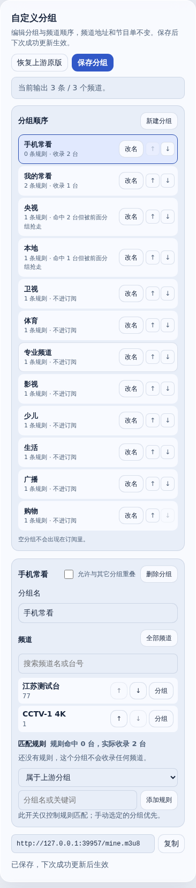
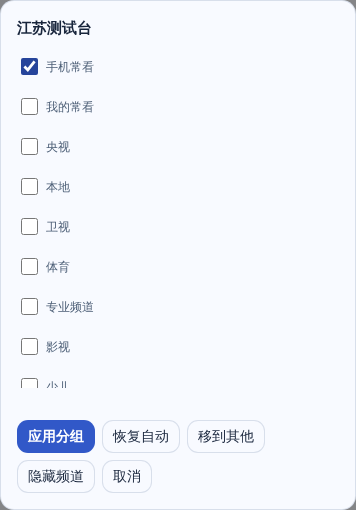

# 江苏移动 IPTV · 飞牛 fnOS 应用

在飞牛 NAS 上看江苏移动电视直播和回看，也能把自己分好组、排好顺序的频道订阅到电视、手机和盒子。

  

[快速开始](#quickstart) · [自定义分组和排序](#custom-groups) · [播放器接入](#players) · [常见问题](#faq)

## 快速开始

需要 fnOS **1.1.3100 或更新版本**、Python **3.8+**，以及可访问直播源的**江苏移动网络**。应用无需额外安装 Python 第三方库。

1. 下载 [最新版 FPK](https://github.com/justinguo7777/jsydiptv/releases/latest)，在飞牛「应用中心 → 手动安装」选择安装包。
2. 在安装向导填写服务端口，默认 `18123`。打开飞牛桌面上的应用，或用浏览器访问 `http://<NAS-IP>:18123/`，端口以安装时填写的为准。
3. 首次启动会在后台生成清单。生成后可在「观看」选台，或在「订阅」复制地址到播放器。默认每天 03:30 更新，也可在「设置 → 清单更新」点「立即更新」。

> **已安装撤下的旧 `1.7.4`？** 请先备份配置和数据，再卸载旧包、安装当前修订包，并执行一次「立即更新」。直接安装同版本可能跳过覆盖。通过 [v1.7.4 发布页](https://github.com/justinguo7777/jsydiptv/releases/tag/v1.7.4) 获取修订包及校验值。

*界面使用演示频道。观看页支持搜索、收藏、最近频道、节目单和回看。实际频道与节目由上游数据决定。*

## 三套频道清单

| 分组方案 | 适合谁 | 通用清单 | XMLTV 节目单 |
| --- | --- | --- | --- |
| **智能**（默认） | 按央视、卫视、江苏、地市、体育等分类找台 | `iptv.m3u8` | `epg.xml` |
| **原版** | 习惯机顶盒的上游分组。保留组归属，顺序可能不同 | `orig.m3u8` | `orig_epg.xml` |
| **自定义** | 自己决定频道放在哪些组、在组内排第几 | `mine.m3u8` | `epg.xml` |

三套清单可同时订阅。网页「观看」可切换分组方案，更改自定义布局只会更新自定义清单。

## 自定义分组和频道排序

进入「**设置 → 自定义分组**」。首次使用以上游分组为起点。

1. **改组名或调整组顺序**。点组名旁的「改名」后编辑组名。也可以新建分组，用组旁的 ↑ / ↓ 调整组顺序。
2. **移动频道、加入多个组或隐藏**。在「全部频道」或搜索结果里找到频道，点旁边的「分组」。勾选希望保留的组，再点「应用分组」。只勾目标组就是移动，勾多个组可让频道在多处出现。菜单也可「恢复自动」「移到其他」或「隐藏频道」。
3. **单独排列每组频道**。清空搜索并打开要排序的分组，用频道旁的 ↑ / ↓ 调整。电脑也可以拖动组内频道。请在具体分组内排序，「全部频道」、搜索结果和「其他」用于查找或归组。
4. **应用到网页和订阅**。点「保存分组」，再到「清单更新」点「立即更新」。更新成功后，在「观看 → 自定义」检查顺序，或在「订阅 → 自定义」复制清单地址。已订阅的播放器可以手动刷新。

查看手机端分组、排序和频道分配示例

*截图使用演示频道。请从自己可访问的 NAS 页面复制订阅地址。*

## 播放器接入

用播放设备可访问的 NAS 地址打开网页，从「**订阅 → 按播放器**」或对应分组页复制链接。下表列的是地址末尾的文件名。

| 播放器 | 智能分组 | 自定义分组 | 节目单 |
| --- | --- | --- | --- |
| **FongMi TV** | `fongmi.json` 内选择智能直播 | 同一配置内选择自定义直播，或单独订阅 `mine_fongmi.m3u` | 配置内含按日节目单。单独使用 M3U 时可配 `epg.xml` |
| **Kodi IPTV Simple** | `kodi.m3u` | `mine_kodi.m3u` | `epg.xml`，并在客户端启用回看 |
| **APTV / 酷9 / 电视直播 / DIYP** | `iptv.m3u8` | `mine.m3u8` | `epg.xml`。酷9 的 EPG 解析格式选择 **XmlTV** |
| **TVBox / 影视仓** | `tvbox.json` 或 `iptv.m3u8` | 在直播设置中添加 `mine.m3u8` | 使用 M3U 时可配 `epg.xml`，以客户端功能为准 |

FongMi 的 `fongmi.json` 也有「原版」直播入口。使用原版通用清单时，将 `orig.m3u8` 与 `orig_epg.xml` 配对。客户端的回看能力取决于版本与设置。

回看格式与节目单范围

- 通用、原版和 FongMi 清单使用 `${(b)yyyyMMddHHmmss}` 与 `${(e)yyyyMMddHHmmss}`。Kodi 使用 `${start:YmdHMS}` 与 `${end:YmdHMS}`，请选 Kodi 专用清单并将播放设备时区设为 `Asia/Shanghai`。
- 开启 EPG 后，XMLTV 最多包含前 5 天至次日的节目，取决于实际抓取结果。FongMi 配置内的按日 JSON 覆盖当天及已抓取的未来日期，历史节目可查看 XMLTV。
- 精简和完整模式均生成三套分组清单。完整模式额外输出 TXT、CSV 等格式。关闭 EPG 在下次成功更新后生效，XMLTV 将只保留频道条目，FongMi 配置将移除按日 EPG 地址。直播和有回看模板的清单仍可用。

## 常见问题

- **保存分组后顺序没变**。确认「立即更新」成功，再切换到「自定义」或刷新外部播放器订阅。更新失败时应用继续提供上一套有效清单。
- **点回看仍是直播**。核对是否选对播放器清单、是否开启客户端回看。运营商通常只保留约 7 天，具体视频道与节目而定。
- **4K 台有声无画**。检查设备是否支持 HEVC。网页在有兼容直播档时可切换，也可用支持该编码的播放器。只有实测达到 3840×2160 的频道才有真 4K 标记。「臻享」和「待探测」频道也可能出现在高画质分组。
- **飞牛桌面图标打不开**。先确认应用运行正常，再用 NAS 地址和实际端口访问。桌面入口在安装时登记，后来改端口可能需要重装才能重新登记。

仅在受信任的局域网使用。应用未内置访问鉴权，请避免将服务直接暴露到公网。使用直播与回看请遵守运营商条款及适用规定。

## 开发与反馈

[开发与打包](docs/development.md) · [验收清单](docs/verification.md) · [历史版本](https://github.com/justinguo7777/jsydiptv/releases) · [问题反馈与功能建议](https://github.com/justinguo7777/jsydiptv/issues)

感谢恩山 **lff520520** 分享思路与实现方案。[原帖](https://www.right.com.cn/forum/thread-8499027-1-2.html)

项目源码使用 [MIT License](LICENSE)。随附的 hls.js 使用 [Apache-2.0 许可](third-party/hls.js/README.md)。软件许可不授予节目或直播流的使用或转播权。
